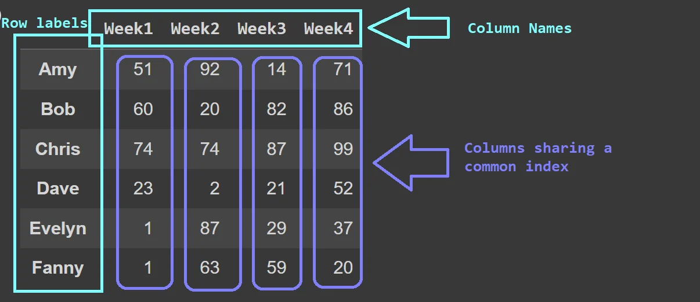
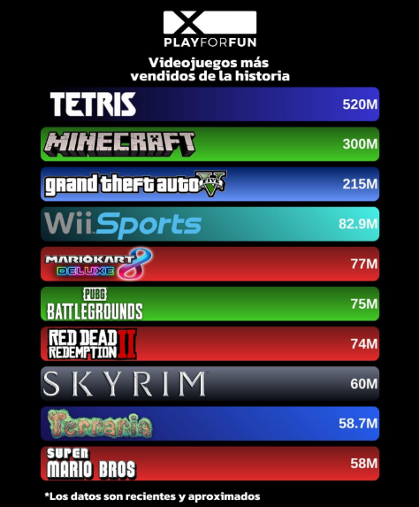
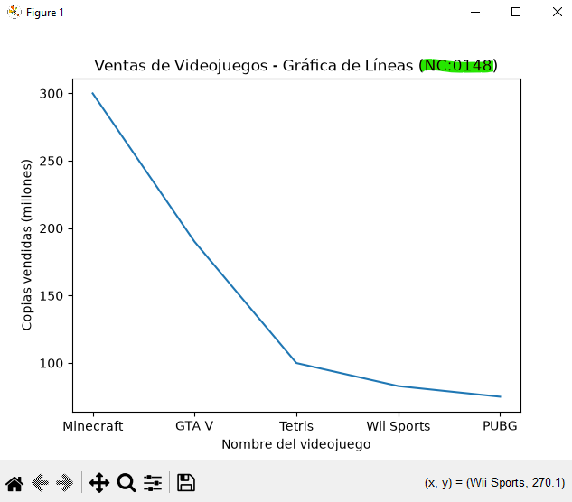
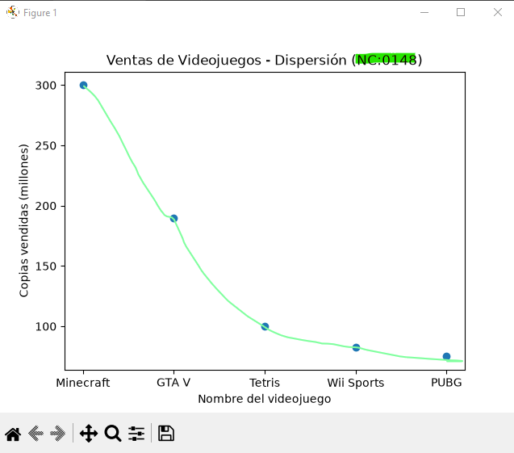
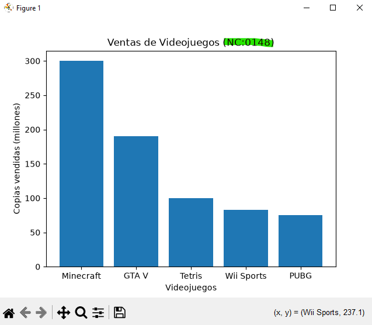
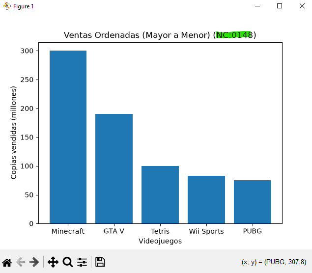
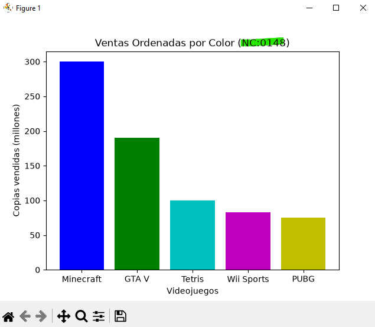
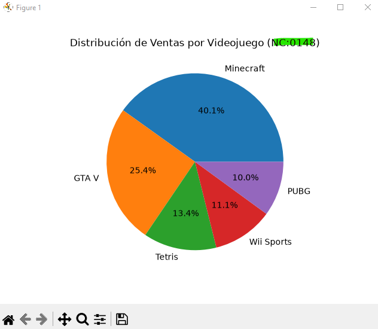

## DataFrame o Marco de datos en Pandas

## Videojuegos a nivel mundial 

## Grafica de lineal de Videojuegos 

## Grafica de puntos de Videojuegos

## Grafica de barras de Videojuegos 

## Grafica de barras del mas grande al mas chico

## Coloreando la grafica

## Grafica de pastel (Pie)
